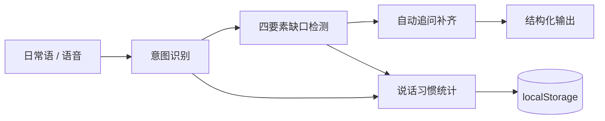

# 提示词转换器（prompt-converter）

把杂乱的日常话（尤其语音）转成结构化提示词：识别意图 → 补缺口 → 结构化输出。单文件、零依赖、离线可用。

## Problem

佳慧的日常表达（尤其语音）「杂乱」：一段话塞多个诉求、缺背景、缺验收标准。AI 只能猜，结果慢且偏。需要的不是更会「说」，而是一个把日常语 → 结构化提示词的**前置转换器**。

## Why This

与其靠自律时刻提醒自己「说清楚」，不如让一个工具在出口处拦截——输入杂乱的话，自动识别意图、追问缺失的四要素、吐出结构化提示词。规则来自她自己的《写提示词技巧.txt》五条铁律（背景 + 目标 + 约束 + 验收标准、一次一目标、验收写清楚、先问解决什么问题再问技术、跨窗口交接文档）。

## Architecture

单文件 HTML，无构建、无后端。流程：

## Skills

| 能力 | 说明 |
|---|---|
| 意图识别 | 8 类意图（做产品 / 决策 / 调研 / 分析人 / 商业模式 / 学习 / 复盘 / 通用），关键词匹配 + 建议框架 |
| 缺口检测 | 四要素（背景 / 目标 / 约束 / 验收）正则检测，缺哪个补哪个 |
| 语音 | Web Speech API：语音输入、TTS 语音追问、按住 Alt 说话松开识别 |
| 自我进化 | localStorage 累积说话习惯：平均一次几件事、平均漏几个要素、高频意图 |

## Tools

- Web Speech API（语音识别 + 合成）
- localStorage（习惯统计持久化）
- 正则 + 负向后行断言（约束检测）
- Blueprint 设计风格（复用 second-brain 的 design token）

## Memory

localStorage 记录 `prompt-converter-stats`：累计转换次数、各意图频次、平均诉求数、平均缺失要素数、最常漏的要素。转换 ≥3 次后开始输出「说话习惯画像」洞察。

## Eval

验收标准（规则 3：能跑 / 能看 / 有数据）：
- 能跑：双击打开即用，Chrome / Edge 语音可用
- 能看：四步卡片逐步展开（输入 → 识别 → 补缺口 → 输出）
- 有数据：localStorage 累积统计，5 次后显示高频意图画像

## Failure Cases

- **「要不要」污染「不要」**：约束检测时，「我要不要学」会被误判成「不要」约束。用负向后行断言 `(?<!要)不要` 排除——「要不要」里的「不要」前面有「要」，不匹配。

## Design Decisions

1. **分阶段，不上 Electron**：先网页语音版（轻便、零依赖），全局 Alt 唤起纯网页做不到（硬边界），下一步再上 Electron 悬浮窗。
2. **单文件零依赖**：一个 HTML 搞定，离线可用，方便分发和改。
3. **复用 Blueprint 风格**：和 second-brain 同一套设计 token，视觉一致。
